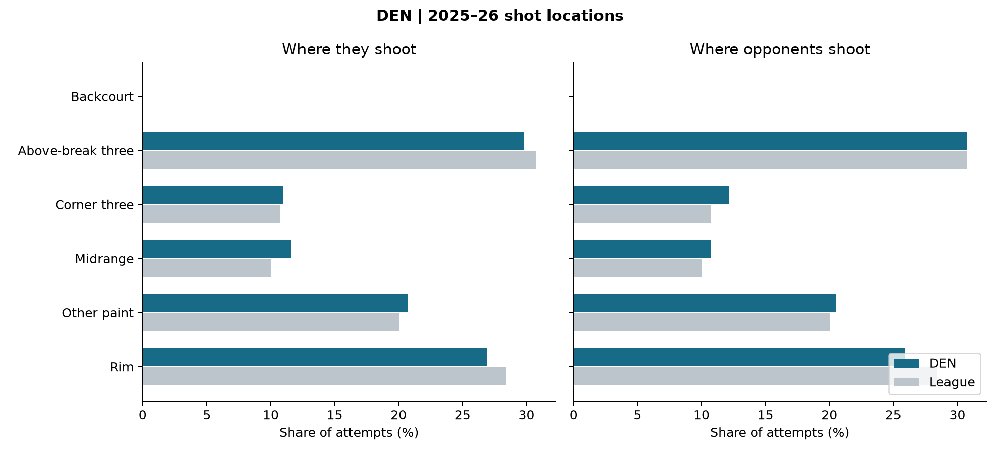

# DEN: opponent scouting sheet

Joseph Smarrelli · September 2026

2025–26 regular season. 80 audited team games. The league reference uses 1,212 games that reconcile across event and shot records.

| Metric | Offense | Opponents |
| --- | ---: | ---: |
| eFG% | 57.6% | 54.3% |
| Turnovers / estimated possessions | 12.6% | 11.6% |
| Player-rebound OREB% | 23.7% | 24.9% |
| FTA / FGA | 29.4% | 25.4% |

## Film review priorities

**Separate direct scoring from passing possessions.** A shot profile records the final shooter. Review the entry, help decision and pass sequence around Denver’s primary creators before assigning a defensive cause.

**Track the rebound after the contest.** Compare defensive recoveries and Denver offensive rebounds from similar miss locations. Team rates alone do not identify who missed an assignment.

**Check the current personnel.** The completed-season profile mixes historical lineups. Confirm the players and rotations expected in the upcoming matchup before choosing film examples.

## Definitions and limits

Estimated possessions = FGA − player offensive rebounds + turnovers + 0.44 × FTA. Offensive-rebound percentage uses the offense’s player offensive rebounds divided by those rebounds plus the opponent’s player defensive rebounds. Team rebounds are excluded. These are documented public-data approximations; they are not asserted to match the official four-factor tables. Turnover rate uses estimated possessions rather than the alternative FGA + 0.44 × FTA + TOV denominator.

The defensive panel reports opponent offense. The figures contain no tracking, matchup adjustment or shot-clock information. Film priorities are proposed review questions; no film has been coded. Update availability and rotations before using this historical sheet for a game.

Source: [pinned public NBA archive](https://github.com/shufinskiy/nba_data/tree/e829d4678be1e075f99e5d41a1c5f97089be446b). Source checksums, excluded games, team-game inputs and formulas are included in the repository.
