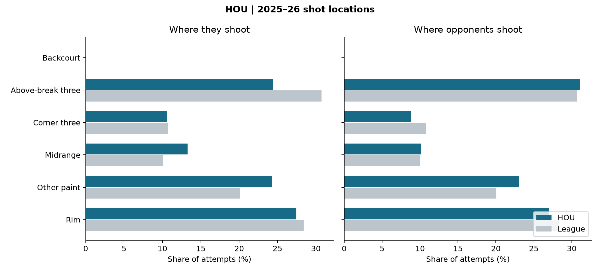

# HOU: opponent scouting sheet

Joseph Smarrelli · September 2026

2025–26 regular season. 80 audited team games. The league reference uses 1,212 games that reconcile across event and shot records.

| Metric | Offense | Opponents |
| --- | ---: | ---: |
| eFG% | 54.4% | 53.1% |
| Turnovers / estimated possessions | 15.4% | 13.4% |
| Player-rebound OREB% | 34.9% | 25.6% |
| FTA / FGA | 26.1% | 25.0% |

## Film review priorities

**Review perimeter rebounding responsibilities.** Compare Houston offensive rebounds after threes with similar misses the defense secured. Identify first contact, the eventual rebounder and outlet protection.

**Separate the shot from the second chance.** A possession with several misses can end in a score. Review offensive-rebound sequences alongside the field-goal location profile.

**Compare both sides of the floor.** Use the offense and defense panels to define separate review questions. These descriptive rates do not establish the value of a different scheme.

## Definitions and limits

Estimated possessions = FGA − player offensive rebounds + turnovers + 0.44 × FTA. Offensive-rebound percentage uses the offense’s player offensive rebounds divided by those rebounds plus the opponent’s player defensive rebounds. Team rebounds are excluded. These are documented public-data approximations; they are not asserted to match the official four-factor tables. Turnover rate uses estimated possessions rather than the alternative FGA + 0.44 × FTA + TOV denominator.

The defensive panel reports opponent offense. The figures contain no tracking, matchup adjustment or shot-clock information. Film priorities are proposed review questions; no film has been coded. Update availability and rotations before using this historical sheet for a game.

Source: [pinned public NBA archive](https://github.com/shufinskiy/nba_data/tree/e829d4678be1e075f99e5d41a1c5f97089be446b). Source checksums, excluded games, team-game inputs and formulas are included in the repository.
