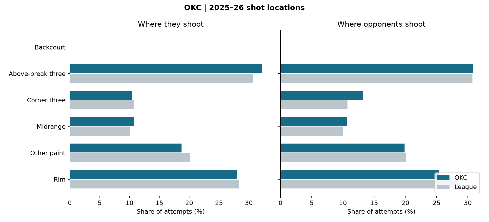

# OKC: opponent scouting sheet

Joseph Smarrelli · September 2026

2025–26 regular season. 82 audited team games. The league reference uses 1,212 games that reconcile across event and shot records.

| Metric | Offense | Opponents |
| --- | ---: | ---: |
| eFG% | 56.1% | 51.9% |
| Turnovers / estimated possessions | 12.3% | 16.3% |
| Player-rebound OREB% | 22.3% | 25.6% |
| FTA / FGA | 26.1% | 24.8% |

## Film review priorities

**Locate the corner passes.** Review the pass before each corner attempt against OKC, including attempts to reach the corner that end in turnovers. A location share alone does not show whether the shot was open.

**Review foul trips separately.** Pair shot outcomes with shooting and nonshooting foul sequences. Field-goal percentage omits trips to the line that never create a field goal attempt.

**Tag the first defensive rotation.** Use the possession record to locate help, the next pass and the recovery. The public data here do not identify those actions or prescribe a coverage.

## Definitions and limits

Estimated possessions = FGA − player offensive rebounds + turnovers + 0.44 × FTA. Offensive-rebound percentage uses the offense’s player offensive rebounds divided by those rebounds plus the opponent’s player defensive rebounds. Team rebounds are excluded. These are documented public-data approximations; they are not asserted to match the official four-factor tables. Turnover rate uses estimated possessions rather than the alternative FGA + 0.44 × FTA + TOV denominator.

The defensive panel reports opponent offense. The figures contain no tracking, matchup adjustment or shot-clock information. Film priorities are proposed review questions; no film has been coded. Update availability and rotations before using this historical sheet for a game.

Source: [pinned public NBA archive](https://github.com/shufinskiy/nba_data/tree/e829d4678be1e075f99e5d41a1c5f97089be446b). Source checksums, excluded games, team-game inputs and formulas are included in the repository.
